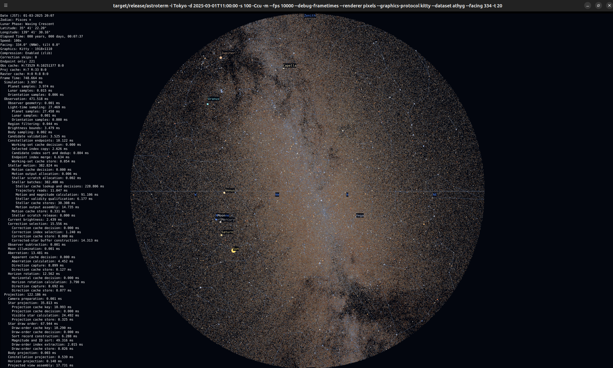
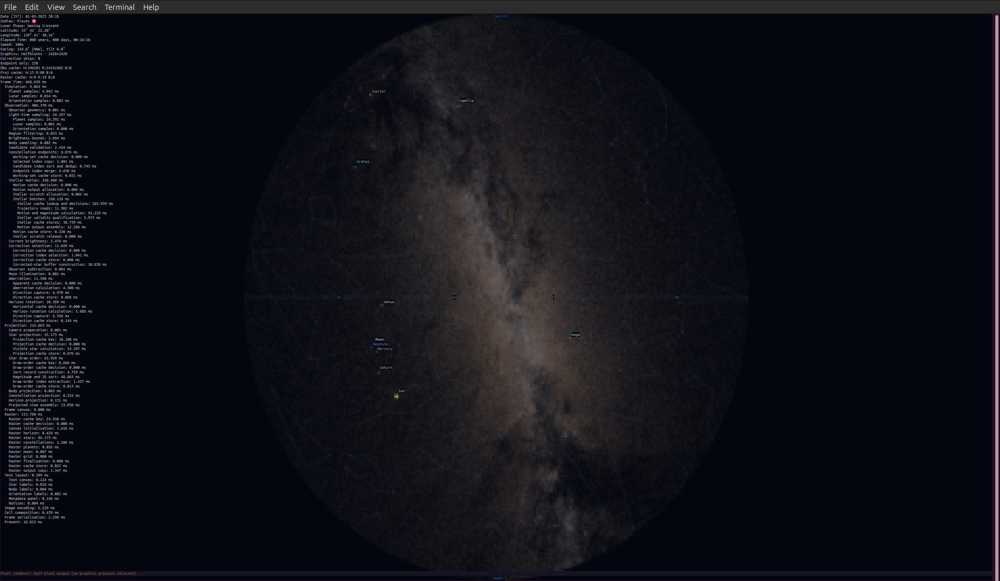

# astroterm-rs

A Rust port of astroterm with some extra stuff. 
A terminal star map showing stars, planets, the Moon, and constellations.

> [NOTE]  
> This code is ported from [astroterm](https://github.com/da-luce/astroterm) by  
> [da-luce](https://github.com/da-luce) (Dalton Luce), and further work on it is inspired by the original project.  
> All credit for the original design, algorithms and data preparation goes there.



*Pixel rendering with the AT-HYG catalog in Kitty.*



*The same sky as colored half-blocks, for terminals without a graphics protocol.*

## Usage

With Rust and Cargo installed, run these commands from the project folder:

```sh
cargo build --release
./target/release/astroterm -i Tokyo -C -m
```

**Arrow keys look around, `+` / `-` zoom, Space pauses, and `q` quits.**

## More stars

The built-in Bright Star Catalog works offline without downloads. For about 2.5 million stars, use AT-HYG:

```sh
./target/release/astroterm -i Tokyo --dataset athyg -t 8 -C
```

For a larger, partial-sky Gaia subset:

```sh
./target/release/astroterm -i Tokyo --dataset gaia-gdr3 --dataset-stars 1000000 -t 10
```

MAST downloads only needed columns and reuses converted blocks when you increase the count.
Use `--dataset-files 1` instead for ESA bulk files. See [Gaia loading and limitations](docs/gaia-dataset.md).

Dataset loading shows progress before the sky opens. Use `--no-progress` to hide progress updates.
With `-m`, the panel shows the stars loaded, the stars and regions selected for the view and the tile memory held.

## Views

```sh
# Constellations and the metadata panel
./target/release/astroterm -i Tokyo -C -m

# Look north-northwest, 20° above the horizon
./target/release/astroterm -i Tokyo --facing NNW --tilt 20 --fov 120 -C

# Freeze the sky at a specific date and time (UTC)
./target/release/astroterm -i Tokyo -d 2025-03-01T11:00:00 -s 0 -C -m

# Use coordinates instead of a city: latitude, then longitude
./target/release/astroterm -a 1.29 -o 103.85 -C
```

Without `--facing`, the view is centered overhead. Looking around with the arrow keys switches to a facing view.

The sky is drawn as pixels: Kitty, Sixel or iTerm2 graphics are detected, with colored half-blocks as the fallback.
A local Kitty terminal receives each frame through shared memory; other Kitty terminals (and tmux) get a
compressed stream. If graphics look wrong, try `--graphics-protocol halfblocks`. To choose a supported protocol
yourself, use `--graphics-protocol kitty`, `sixel` or `iterm2`.

Use `--text-scale 0.7` for smaller pixel text or `--text-scale 1.2` for larger text
(default: `0.85`). This affects Kitty/Sixel/iTerm2 only; half-blocks use your terminal's font size.

## Useful options

| Option | What it does |
|---|---|
| `-C` | Draw constellation lines |
| `-u` | Unicode in labels and the panel (Greek letters in Bayer designations, zodiac symbols) |
| `-m` | Show the date, location and simulation speed |
| `-s 100` | Run time 100× faster; `-s 0` starts paused |
| `-t 8` | Show fainter stars; default is `5`. Higher values show more stars and can be slower |
| `--fov 60` | Zoom into a smaller patch of sky |
| `--fps 24` | Set the frame-rate target; the default is 12 |
| `--n-jobs 4` | Use four projection worker threads; `0` (default) runs directly, `-1` uses available logical CPUs |
| `-R` | Include atmospheric refraction near the horizon |

For all options: `./target/release/astroterm --help`.

Dates supplied with `-d` are UTC; the panel uses the observer's local time zone when available.
Dates use the Gregorian calendar throughout history, with year `0` meaning 1 BC and `-1` meaning 2 BC.
A yellow warning marks dates outside tested accuracy ranges. Drawn object sizes are schematic.

## Keys

| Key | Action |
|---|---|
| Arrows or `h` `j` `k` `l` | Look around |
| `+` / `-` | Zoom in / out |
| Space | Pause / resume |
| `]` / `[` | Speed up / slow down by 10× |
| `r` | Reverse time |
| `0` | Reset the view |
| `q`, Esc or Ctrl-C | Quit |


The first run downloads about **200 MB**; later runs reuse the file offline.
You can also supply a local AT-HYG CSV or compressed CSV: `--dataset ./athyg_40.csv.gz`.
Catalogs requiring special high-precision trajectories or near-zero-distance handling during preparation currently
stop with an explicit “not implemented” error; support for sparse star exceptions is pending.

On Linux, the default locations are:

- Download: `~/.local/share/astroterm/athyg_40.csv.gz`
- Prepared catalog cache: `~/.cache/astroterm/`

`XDG_DATA_HOME` and `XDG_CACHE_HOME` override these locations. The cache can be deleted while the app is closed;
it will be rebuilt from the dataset.

<details>
<summary>Optional setup and diagnostics</summary>

Enable Bash completions for the current shell:

```sh
source <(./target/release/astroterm --bash-completions)
```

- `make build-debug`: build `target/pixel-debug/astroterm` with [pixel arithmetic checks](docs/pixel-debug.md).
- `--debug-frametimes`: show each frame stage with indented sub-step timings, including cache work, region mapping, rasterization, and terminal output. Values use completed-frame averages.
- `--debug-singleframe`: display one frame, then exit and print a detailed timing report.
- Multi-frame timing: see [bounded frame captures](docs/frame-benchmarks.md) for reproducible per-frame reports.

</details>

## Differences from the C version

Gaia DR3 subsets are supported through ESA bulk files or selective MAST Parquet downloads, using G brightness
in the existing magnitude field. The MAST path removes identical adjacent copies from a known provider duplication.

The Sun, Moon and planets are evaluated every frame; an unchanged frame sends nothing to the terminal.

Simulation timestamps are signed integer milliseconds since Gregorian year 0, with uniform days and no leap-second handling.
Dates accept an optional `.sss` fraction. Fractional playback speeds retain sub-millisecond progress internally;
astronomical formulas convert dates to their required time scales on demand without rounding light-time calculations.
The integer storage range does not extend the models' scientific accuracy range. Existing raw downloads are preserved;
prepared catalogs may be rebuilt after this time-representation change.

Optional [frame timing captures](docs/frame-benchmarks.md) run a fixed number of frames at reproducible simulated dates.

Catalog brightness is stored in steps of 0.001 magnitude; values very close to a display threshold may round across it.
Stars are filed by their catalog-epoch sky regions with a fixed motion allowance of 0.25°. At distant dates,
fast-moving stars may be missing from a view; special handling for them is currently deferred.
Each region's stars are sorted into three speed groups with TTLs assigned from `SPEED_GROUP_TTL_MS` at
startup: longest for the slowest group, shortest for the fastest (currently 365, 10 and 1 simulated days).
Constellation stars use the fastest group's TTL. The drawn stars of a region are kept as a 64 × 64 sky-fixed tile that is
re-rendered only when its simulation or the brightness threshold changes, and the screen is produced by mapping
every pixel of a region's screen image back to its tile and filtering the texels under it. Tiles of regions that leave the view stay in memory for their return.
The fixed holds have known direction-error exceptions; the opt-in [offline hold audit](docs/stellar-hold-audit.md)
reports them without changing the runtime policy.

Final image composition uses four-pixel SSE2 batches on x86-64, preserving the scalar brightness,
blending and byte-rounding formulas. Other architectures and `pixel-debug` builds use the portable scalar
compositor; checked builds retain their per-pixel validation and accumulated-light reporting. Composition
uses one thread independently of `--n-jobs`.

Projection can use a dedicated thread pool with `--n-jobs`: `0` creates no projection pool, `1` creates one
worker, and positive values request that many workers. `-1` uses the logical CPUs available to the process.
This setting does not change catalog loading, downloading, sorting or other frame steps. Both direct and
worker execution use the same independent region loop; workers borrow only their assigned tiles. The executor
creates one reusable image vector and touched-screen-block list per worker. Each job clears only previously
written blocks, then records its new written ranges while drawing. Screen blocks are 16 × 16 pixels by default
(`PROJECTION_SCREEN_BLOCK_SIZE` in `constants.rs`), independent of the sky regions. Completed images and their
block lists return together through a completion channel. The main thread keeps the first image, copies blocks
not yet touched, and screen-blends overlapping blocks while other jobs continue drawing. Resizing resets block
tracking; the accumulator retains the union of merged blocks for its next clear. Image allocations are retained;
the completed square is borrowed for
frame insertion. Each active image costs about 19 MiB at 1116 × 1116 pixels; capacity can retain a larger prior size.

Stereographic views with multiple workers balance chunks using a cheap projected-area estimate. Direct execution,
one worker and equidistant views do not calculate estimates; equidistant keeps roughly equal region counts.
Selection indices, scheduling weights/chunk ranges and worker timers retain their storage across frames.
The equidistant radial lookup is rebuilt only when its camera scale changes; panning and resizing reuse it.
Screen blending between regions and worker images is mathematically independent of order and grouping, though
completion order can cause tiny floating-point differences. A single large region can still limit speedup.
Screen corrections are calculated independently for each region, including equidistant and refraction views.

This port draws pixel graphics instead of characters (the character renderer of the original was removed), adds
interactive pan/zoom/time controls and optional AT-HYG downloads, and improves astronomical calculations, curved
constellation lines, date handling and observer-local time display.
The five brightest visible stars get labels, using a proper name or catalog identifier. Sun, planet and Moon
labels are independent. Use `--disable-dynamic-names` to hide star labels; the former `--label-thresh` option has
been removed. Independent accuracy checks are documented in
[scripts/reference/README.md](scripts/reference/README.md).

Stars use four-texel dots in their sky tiles, enlarged when zoomed in. Within each group, stars blend from dim
to bright current magnitude (ascending ID for ties); group images merge from slowest to fastest, weighting stored RGB by opacity while opacity accumulates source-over. Zoom brightening is currently disabled (`STAR_BRIGHTNESS_ZOOM_POWER = 0`), so zoom alone does not redraw existing tiles.
Stars whose complete dot would cross the image boundary are omitted. The Sun, planets and Moon retain their sizes.
Tiles are stereographic images of their region, and the screen is a stereographic or equidistant (`-e`) image
of the sky, so every pixel's place in a tile follows from a closed formula. The warp uses it backwards: for every
pixel inside a region's screen image it undoes the screen projection (a division for the stereographic view, a
small scale-keyed lookup table for the equidistant one), refraction (through a fixed table) and aberration, rotates into
the tile and applies the tile projection, then averages the texels under the pixel's footprint and blends the
result with screen blending (`a + b * (1 - a)` for each stored RGB channel and opacity). This keeps stored
channels bounded and never darkens them during merging. The existing final faint-pixel brightness floor still
rescales RGB by opacity, so this is not a guarantee that every displayed colour channel is monotonic.
Filter footprints may overlap the tile even when their centres are outside it; the uncovered
part stays transparent instead of being renormalized to full brightness. Candidate bounds include this filter
support. At the 360° rim, the point behind the observer spreads along the whole edge. Rows are stepped by forward differences, and in the stereographic view rows whose tile rows
hold no light are skipped. Texture footprints are square area averages of the screen's radial scale (the
equidistant view blurs a little more along the rim than across it); the cached tile resolution is unchanged, so
extreme magnification can still look blurry.
Minimum-size filter footprints wholly inside a tile use a direct four-texel bilinear calculation, equivalent
to the existing unit box filter. On x86-64, SSE2 accumulates its RGBA channels in f64 pairs while preserving
texel order; other architectures use the scalar calculation. Pixel-debug output checks apply to both paths.
Larger footprints and tile boundaries retain the general box filter.
Set `PROJECTION_USE_BILINEAR_FAST_PATH` to `false` in `src/constants.rs` and rebuild to disable this shortcut.
With the azimuthal grid on, its angle labels replace the compass letters.

<details>
<summary>Credits, citations and data sources</summary>

## Citations

Resources used by the original astroterm and this port:

- [astroterm](https://github.com/da-luce/astroterm) by Dalton Luce, the project this code is ported from
- [Map Projections - A Working Manual by John P. Snyder](https://pubs.usgs.gov/pp/1395/report.pdf)
- [Wikipedia](https://en.wikipedia.org)
- [Atractor](https://www.atractor.pt/index-_en.html)
- [Jon Voisey's Blog: Following Kepler](https://jonvoisey.net/blog/)
- [Celestial Programming: Greg Miller's Astronomy Programming Page](https://astrogreg.com/convert_ra_dec_to_alt_az.html)
- [Practical Astronomy with your Calculator by Peter Duffett-Smith](https://www.amazon.com/Practical-Astronomy-Calculator-Peter-Duffett-Smith/dp/0521356997)
- Astronomical Algorithms by Jean Meeus
- [NASA Jet Propulsion Laboratory](https://ssd.jpl.nasa.gov/planets/approx_pos.html)
- [Paul Schlyter's "How to compute planetary positions"](https://stjarnhimlen.se/comp/ppcomp.html)
- [Dan Smith's "Meeus Solar Position Calculations"](https://observablehq.com/@danleesmith/meeus-solar-position-calculations)
- [Bryan Weber's "Orbital Mechanics Notes"](https://github.com/bryanwweber/orbital-mechanics-notes)
- [ASCOM](https://ascom-standards.org/Help/Developer/html/72A95B28-BBE2-4C7D-BC03-2D6AB324B6F7.htm)

Additional accuracy-model sources:

- [Bretagnon & Francou (1988), VSOP87](https://ui.adsabs.harvard.edu/abs/1988A%26A...202..309B/abstract): the
  complete VSOP87E series from [IMCCE](https://ftp.imcce.fr/pub/ephem/planets/vsop87/) in `data/vsop87/`, packed
  at build time and summed with their time derivatives (`data/vsop87/provenance.md`).
- [Vondrák, Capitaine & Wallace (2011/2012), long-term precession](https://www.aanda.org/articles/aa/abs/2011/10/aa17274-11/aa17274-11.html).
- [ERFA](https://github.com/liberfa/erfa): long-term pole and IAU 2000B nutation coefficients; translated code is
  covered by [LICENSE-ERFA](LICENSE-ERFA), with its SOFA heritage acknowledged there.
- [Espenak–Meeus ΔT polynomials](https://eclipse.gsfc.nasa.gov/SEcat5/deltatpoly.html).
- Jean Meeus, *Astronomical Algorithms*, second edition, chapters 22 and 47 (lunar tables 47.A/B).
- [WGS84](https://earth-info.nga.mil/index.php?dir=wgs84&action=wgs84): equatorial radius 6378137 m,
  inverse flattening 298.257223563, height 0.
- [JPL DE440/DE441](https://ssd.jpl.nasa.gov/planets/eph_export.html) and
  [Horizons](https://ssd.jpl.nasa.gov/horizons/manual.html) for independent comparisons.

## Data Sources

The files in `data/` are taken from the original astroterm repository:

- Stars: [Yale Bright Star Catalog](http://tdc-www.harvard.edu/catalogs/bsc5.html)
- Star names: [IAU Star Names](https://www.iau.org/public/themes/naming_stars/)
- Constellation figures: [Stellarium](https://github.com/Stellarium/stellarium/blob/3c8d3c448f82848e9d8c1af307ec4cad20f2a9c0/skycultures/modern/constellationship.fab#L6)
  (converted from [Hipparcos](https://heasarc.gsfc.nasa.gov/w3browse/all/hipparcos.html) to
  [BSC5](http://tdc-www.harvard.edu/catalogs/bsc5.html) indices using the
  [HYG Database](https://www.astronexus.com/projects/hyg), see astroterm's
  [convert_constellations.py](https://github.com/da-luce/astroterm/blob/main/scripts/convert_constellations.py))
- Cities: [GeoNames](https://download.geonames.org/) (filtered and condensed using astroterm's
  [filter_cities.py](https://github.com/da-luce/astroterm/blob/main/scripts/filter_cities.py))
- Time-zone boundaries: [timezone-boundary-builder](https://github.com/evansiroky/timezone-boundary-builder),
  derived from © [OpenStreetMap contributors](https://www.openstreetmap.org/copyright), distributed through
  [tzf-dist](https://github.com/ringsaturn/tzf-dist) under the [ODbL 1.0](https://opendatacommons.org/licenses/odbl/1-0/).
- Planet orbital elements: [NASA Jet Propulsion Laboratory](https://ssd.jpl.nasa.gov/planets/approx_pos.html)

Added by this port:

- Planetary ephemeris: the complete [VSOP87E](https://ftp.imcce.fr/pub/ephem/planets/vsop87/) series of
  Bretagnon & Francou (IMCCE), the unmodified published text files in `data/vsop87/`, packed by `build.rs` at
  compile time; checksums in `data/vsop87/provenance.md`.

Optional, not distributed with this repository:

- Larger star dataset for `--dataset`: [AT-HYG](https://codeberg.org/astronexus/athyg) (Augmented Tycho-HYG) by
  David Nash / astronexus, about 2.5 million stars from Tycho-2, Gaia DR3 and HYG, licensed
  [CC BY-SA 4.0](https://creativecommons.org/licenses/by-sa/4.0/). `--dataset athyg` downloads the pinned v4.0 file
  from its [Git LFS media URL](https://codeberg.org/astronexus/athyg/media/branch/main/data/athyg_40.csv.gz) into the
  per-user data folder. Manual copies can be placed anywhere, including the gitignored `datasets/` folder.

- Gaia DR3 main-source subsets: [ESA/Gaia/DPAC](https://www.cosmos.esa.int/web/gaia/dr3).
  Only the checksum manifest is bundled; selected star files are downloaded separately.
  See [conversion details and acknowledgements](docs/gaia-dataset.md).

</details>

## License

MIT, see [LICENSE](./LICENSE). The original copyright notice of astroterm is kept there.

The unmodified bundled [DejaVu Sans Mono](https://dejavu-fonts.github.io/) font is distributed under its
[Bitstream Vera/DejaVu license](data/fonts/LICENSE-DejaVu.txt); its license notice is also embedded in the font file.
